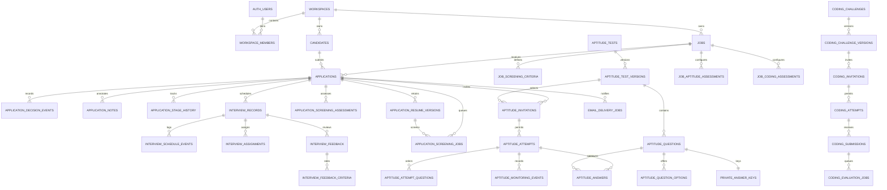

# ProofHire database audit and architecture

Audit scope: repository files in this worktree on 2026-11-02. This is a
repository audit, **not** a statement about the live Supabase project. No
database was queried or changed.

## What was and was not verified

- The migration chain and its callers in the frontend, Go backend, and Edge
  Function were inspected.
- The worktree has no `.supabase` project-link metadata. The Supabase CLI,
  Docker, `psql`, and `pg_ctl` are not installed. No Supabase access token,
  database password, URL, or service-role key is present in the process
  environment.
- Consequently, the live project's migration history, tables, grants, RLS,
  functions, extensions, bucket configuration, and data are **unknown**.
  Migration files alone do not prove that any migration has been applied.
- No generated Supabase TypeScript database types were found. Existing frontend
  data models are hand-maintained; generated types were not fabricated.
- The working tree already contains user/local changes. In particular,
  `202610240003_public_application.sql` has a local change from application
  status `applied` to `new`. That change was preserved. The screening migration
  from earlier local work is also untracked in this worktree. Do not discard
  either without the owner's direction.

## Migration history

Apply the files in timestamp order. Do not skip migrations or edit historical
files that may already have run:

| Migration | Purpose and evolution |
|---|---|
| `202610240001_initial_schema.sql` | Creates workspaces, memberships, jobs, candidates, and applications; same-workspace composite FKs; initial application/job statuses; timestamp and new-user triggers. |
| `202610240002_security_policies.sql` | Adds workspace membership/role helpers and RLS for the five core tables. Members read workspace data; owners/admins/recruiters perform role-scoped writes. Public can read open jobs. |
| `202610240003_public_application.sql` | Adds the six-argument `submit_public_application` security-definer RPC and narrowly scoped execution grant. The worktree's local copy uses `new` rather than the historical `applied` initial status. |
| `202610240004_resume_storage.sql` | Creates/updates private `candidate-resumes` bucket and upload/read/update/delete policies. |
| `202610260001_job_requirements.sql` | Adds required/preferred skill arrays and nonnegative minimum experience. |
| `202610260002_workspace_profile_and_account_deletion.sql` | Adds company profile columns, deletion request table, 15-day request/cancel RPCs, and service-role claim RPC. |
| `202610260003_candidate_management_schema.sql` | Adds LinkedIn URL, makes candidate email nullable, maps `applied` to `new` and `selected` to `hired`, then establishes the six current application statuses. |
| `202610260004_public_application_status_and_duplicates.sql` | Replaces the public submission RPC with the same six-argument signature, normalized duplicate matching, and non-mutating duplicate handling. |
| `202610260005_candidate_workspace_email_normalized_unique.sql` | Adds a partial unique index on workspace plus normalized non-null email. It fails if existing normalized duplicates are present. |
| `202610260006_recruiter_decisions_and_interviews.sql` | Adds decision history, decision RPC, interview records, and field-limited interview update privileges. |
| `202610290001_screening_pipeline.sql` | Adds persistent screening jobs, cached criteria, assessments, recruiter RPCs, trigger enqueueing, leases, retries, and service-role operations. |
| `202610290002_account_deletion_and_screening_indexes.sql` | Makes account deletion preserve audit rows by nulling a deleted actor reference and indexes expired screening lease recovery. |
| `202610290003_aptitude_assessment_schema.sql` | Adds versioned aptitude tests, private answer keys, invitations, attempts, answers, monitoring events, and draft publication protections. |
| `202610290004_application_resume_versions.sql` | Backfills application resume history, records future resume-path changes, and links new screening jobs to the exact resume version. |
| `202610290005_status_default_and_deletion_indexes.sql` | Fixes the stale `applications.status` default to `new` and indexes pending/stale account-deletion work. |
| `202610290006_application_notes.sql` | Adds append-only, workspace-scoped recruiter notes for applications. |
| `202610290007_aptitude_assessment_workflow.sql` | Adds aptitude answer-key authoring, manual invitation creation, candidate sessions, autosave, timer enforcement, scoring, and monitoring RPCs. |
| `202611020001_application_stage_history_and_interviews.sql` | Backfills only each application's known current stage, records future stage changes, and adds structured interview scheduling, assignments, feedback, and event history. |
| `202611020002_aptitude_assessment_foundation_completion.sql` | Adds job-specific aptitude configuration, randomized attempt question order, question metadata/scores, and score-detail backfill for previously submitted attempts. |
| `202611020003_coding_assessment_and_email_delivery.sql` | Adds versioned coding challenges, private submissions/test cases, evaluation queue, manual/idempotent email tracking, and the application-stage summary view. |

The reviewed order has no obvious missing prerequisite for a fresh Supabase
database, subject to the platform providing expected `auth` and `storage`
schemas, roles, and extensions. This is not proven until the chain is replayed.
The `pgcrypto` extension's actual schema must be verified: the screening
migration calls `extensions.digest`. There is no separately maintained baseline
and no reason to introduce one unless a fresh local replay demonstrates a
concrete migration-chain failure.

## Current schema inventory

Types below are PostgreSQL types. `id` is UUID unless noted. Primary keys and
notable constraints are called out; FK cascade behavior is explicit where
important. Triggers and policies are summarized in the following sections.
There is no application-owned user-profile table; recruiter profile fields are
currently read from Supabase Auth user metadata.

### Identity and recruitment

| Table | Columns and constraints |
|---|---|
| `workspaces` | `id`, `name` (trimmed length 1–120), `created_by -> auth.users` (`RESTRICT`), `created_at`, `updated_at`; later company website/industry/size/location/phone text columns. |
| `workspace_members` | `(workspace_id, user_id)` PK; both FKs cascade to workspace/auth user; role check: `owner`, `admin`, `recruiter`, `viewer`; `created_at`; index on `user_id`. |
| `jobs` | `id`, `workspace_id -> workspaces` (`CASCADE`), title, department, location, employment type, workplace type, description, status, `created_by -> auth.users` (`RESTRICT`), timestamps; later required/preferred `text[]`, nullable nonnegative `minimum_experience`; composite unique `(id, workspace_id)`; workspace/time and workspace/status indexes. Job status check is `draft`, `open`, `paused`, `closed`; employment/workplace types are also checked. |
| `candidates` | `id`, `workspace_id -> workspaces` (`CASCADE`), full name, nullable email, phone, `resume_path`, `created_by -> auth.users` (`RESTRICT`), timestamps; unique `(workspace_id,email)` plus partial unique `(workspace_id, lower(btrim(email)))` where email is non-null; composite unique `(workspace_id,id)`; later nullable LinkedIn URL. |
| `applications` | `id`, workspace, job, candidate, status, source, cover letter, application resume path, applied/created/updated timestamps, nullable creator (`SET NULL`); composite FKs ensure job and candidate are in the same workspace and cascade on deletion; unique `(job_id,candidate_id)` prevents duplicate applications; composite unique `(workspace_id,id)`; workspace/status, workspace/time, job, and candidate indexes. |
| `account_deletion_requests` | `user_id` PK/FK to auth user (`CASCADE`), request and schedule timestamps, status `pending`/`processing`, nullable processing timestamp. RLS permits the subject to read their own request; no client writes. |
| `application_decision_events` | `id`, workspace, application, decision, note, actor, timestamp; same-workspace application FK cascades; decision check covers shortlist/reject/advance/return/hire. Workspace/time and application/time indexes. The latest forward migration makes a deleted actor nullable with `ON DELETE SET NULL`; event history remains. |
| `application_notes` | `id`, workspace, application, note, nullable actor, timestamp; same-workspace application FK cascades; nonblank note length 1–10,000; workspace/application/time index. Recruiter inserts are append-only; actor references are nulled on user deletion. |
| `application_stage_history` | Append-only workspace/application stage transitions; stores the known current stage for existing rows and records future inserts/status changes, without inventing legacy transitions. |
| `interview_records` | `id`, workspace, application, round, schedule, interview status, outcome, interviewer, feedback, creator, timestamps; same-workspace application FK cascades; unique `(workspace_id,application_id,round_number)`; positive round check and status/outcome checks; workspace/schedule index. New scheduling metadata includes end time, timezone, mode, location/URL, and cancellation time. Deleted actors become null after the forward migration. |
| `interview_schedule_events`, `interview_assignments`, `interview_feedback`, `interview_feedback_criteria` | Workspace-scoped interview history, interviewer assignments, recommendations, and per-criterion ratings; linked by composite workspace/interview keys. Feedback assignment references are nulled if an assignment is removed. |

### AI screening

| Table | Columns and constraints |
|---|---|
| `job_screening_criteria` | Workspace/job IDs, SHA-256 input fingerprint, JSON criteria, model, creation time; same-workspace job FK cascades; unique per `(workspace,job,fingerprint)` and `(workspace,id)`. |
| `application_screening_jobs` | Workspace/application IDs, input fingerprint, queue status, attempts/max attempts (0–5 / 1–5), availability, lease token/worker/expiry, error code/reason, timestamps and completion time; same-workspace application FK cascades; unique `(application_id,input_fingerprint)`; check enforces lease fields only while processing. Claim, workspace, application, and expired-lease indexes. |
| `application_screening_assessments` | Workspace/application, criteria version and screening job, input fingerprint, assessment version, nullable 0–100 score, JSON report, model, token counts, timestamp; composite FKs enforce same workspace; unique application/version and application/fingerprint. Assessment history cascades with its application or queue record. |
| `application_resume_versions` | Workspace/application, resume object path, source, nullable uploader, creation time; same-workspace application FK, unique application/path, workspace/id and workspace/application/id keys. Historical rows use the application's application/creation timestamp as an approximation; new changes are captured by a trigger. New screening jobs link to the current resume-version row; existing jobs remain nullable rather than being incorrectly linked to a newer file. |

Screening statuses: `pending`, `processing`, `retry_wait`,
`waiting_configuration`, `completed`, `failed`, `superseded`. The queue is
database-backed, lease-claimed with `SKIP LOCKED`, and retried with bounded
backoff. AI assessments are advisory; the RPC does not change application
status.

### Aptitude schema foundation

| Table | Columns and constraints |
|---|---|
| `aptitude_tests` | Workspace-scoped title/description, nullable creator, timestamps; `(workspace_id,id)` unique. |
| `aptitude_test_versions` | Workspace/test, positive version number, immutable version title/description, `draft`/`published` state, time limit, max attempts, nullable passing score, publication timestamp, nullable creator, timestamps; same-workspace test FK; unique test/version and workspace/id; status/timestamp consistency check. |
| `aptitude_questions` | Workspace/version, display order, `single_choice`/`multiple_choice`/`short_text`, prompt, positive points, timestamps; same-workspace version FK and unique order; composite keys support answer/version integrity. |
| `aptitude_question_options` | Workspace/question, display order, option text, creation time; same-workspace question FK and unique question/order. |
| `proofhire_private.aptitude_answer_keys` | Workspace/question PK, private JSON key, timestamps; same-workspace question FK. The dedicated schema's access and table grants are service-role-only. |
| `aptitude_invitations` | Workspace/application/test version, candidate email snapshot, SHA-256 token hash (never raw token), status, email delivery state/provider ID/error, expiry, attempt limit, nullable inviter, sent/created/updated timestamps; same-workspace FKs, token hash unique, and composite key for attempt/version integrity. Only safe columns are selectable by authenticated workspace users. |
| `aptitude_attempts` | Workspace/invitation/version, attempt number, status, start/submission timestamps, nullable percentage score and aggregate JSON result; composite FKs ensure matching invitation/version and unique attempt number. Service-role trigger enforces published invitation, expiry, and attempt limits. |
| `aptitude_answers` | Workspace/attempt/version/question, JSON answer, saved timestamp; composite FKs ensure the question is from the exact version used by that attempt. No direct anon/authenticated grants. |
| `aptitude_monitoring_events` | Workspace/attempt, allowlisted event type, JSON metadata and timestamp; same-workspace attempt FK and attempt/time index. Recruiter-role read only. |
| `job_aptitude_assessments` | Published test-version configuration per workspace/job, required flag and display order; same-workspace job/version FKs. |
| `aptitude_attempt_questions`, `proofhire_private.aptitude_answer_scores` | Per-attempt question ordering and private question-level scores; direct client access to assignments/scores is revoked. Historical submitted attempts are backfilled where answer keys and answers exist. |

### Coding assessments, email, and summaries

The coding schema contains workspace-scoped challenges and immutable published
versions, job configuration, invitations, attempts, submissions, and
lease-claimed evaluation jobs. Hidden test cases, submitted source, and
test-case-level execution results live in `proofhire_private`; aggregate
question/attempt scores are readable by workspace recruiters under RLS.
Submission and worker RPCs enforce service-role access and lease tokens.
Submitted code is **not executed** by these migrations; no runner or sandbox is
implemented.

`email_delivery_jobs` and `email_delivery_attempts` provide idempotent
delivery tracking, bounded retry states, and worker leases. Existing aptitude
and scheduled-interview invitations are recorded as manual-required unless
their stored history already indicates delivery. No provider is configured
and no email is sent by this schema.

`application_recruitment_stage_summary` is a `security_invoker` view that
reports application status and the latest screening, aptitude, coding, and
interview outcomes separately. It does not derive or imply a composite hiring
score.

### Column types, defaults, and indexes

`?` means nullable. The following is the concise column-level reference for
the migration-defined tables; status and relationship constraints are listed
above. There are no PostgreSQL enum types: status/category columns are `text`
with `CHECK` constraints.

- `workspaces`: `id uuid PK DEFAULT gen_random_uuid()`, `name text NOT NULL`,
  `created_by uuid NOT NULL`, `created_at timestamptz NOT NULL DEFAULT now()`,
  `updated_at timestamptz NOT NULL DEFAULT now()`, `company_website text?`,
  `company_industry text?`, `company_size text?`, `company_location text?`,
  `company_phone text?`.
- `workspace_members`: `workspace_id uuid`, `user_id uuid`, `role text NOT NULL
  DEFAULT 'owner'`, `created_at timestamptz NOT NULL DEFAULT now()`; composite
  PK `(workspace_id,user_id)`.
- `jobs`: `id uuid PK DEFAULT gen_random_uuid()`, `workspace_id uuid NOT NULL`,
  `title text NOT NULL`, `department text?`, `location text?`,
  `employment_type text NOT NULL DEFAULT 'full-time'`,
  `workplace_type text NOT NULL DEFAULT 'onsite'`, `description text?`,
  `status text NOT NULL DEFAULT 'draft'`, `required_skills text[] NOT NULL
  DEFAULT '{}'`, `preferred_skills text[] NOT NULL DEFAULT '{}'`,
  `minimum_experience numeric?`, `created_by uuid NOT NULL`,
  `created_at/updated_at timestamptz NOT NULL DEFAULT now()`.
- `candidates`: `id uuid PK DEFAULT gen_random_uuid()`,
  `workspace_id uuid NOT NULL`, `full_name text NOT NULL`, `email text?`,
  `phone text?`, `linkedin_url text?`, `resume_path text?`,
  `created_by uuid NOT NULL`, `created_at/updated_at timestamptz NOT NULL
  DEFAULT now()`.
- `applications`: `id uuid PK DEFAULT gen_random_uuid()`,
  `workspace_id/job_id/candidate_id uuid NOT NULL`,
  `status text NOT NULL DEFAULT 'new'` (after migration 290005),
  `source text NOT NULL DEFAULT 'manual'`, `cover_letter text?`,
  `resume_path text?`, `applied_at/created_at/updated_at timestamptz NOT NULL
  DEFAULT now()`, `created_by uuid?`.
- `account_deletion_requests`: `user_id uuid PK`, `requested_at timestamptz NOT
  NULL DEFAULT now()`, `scheduled_for timestamptz NOT NULL`,
  `status text NOT NULL DEFAULT 'pending'`,
  `processing_started_at timestamptz?`.
- `application_decision_events`: `id uuid PK DEFAULT gen_random_uuid()`,
  `workspace_id/application_id uuid NOT NULL`, `decision text NOT NULL`,
  `note text?`, `created_by uuid?` (nullable after migration 290002),
  `created_at timestamptz NOT NULL DEFAULT now()`.
- `application_notes`: `id uuid PK DEFAULT gen_random_uuid()`,
  `workspace_id/application_id uuid NOT NULL`, `note text NOT NULL`,
  `created_by uuid?`, `created_at timestamptz NOT NULL DEFAULT now()`.
- `interview_records`: `id uuid PK DEFAULT gen_random_uuid()`,
  `workspace_id/application_id uuid NOT NULL`, `round_number integer NOT NULL
  DEFAULT 1`, `scheduled_at timestamptz NOT NULL`,
  `interview_status text NOT NULL DEFAULT 'scheduled'`,
  `outcome text NOT NULL DEFAULT 'pending'`, `interviewer_name text?`,
  `feedback text?`, `created_by uuid?` (nullable after migration 290002),
  `created_at/updated_at timestamptz NOT NULL DEFAULT now()`.
- `job_screening_criteria`: `id uuid PK DEFAULT gen_random_uuid()`,
  `workspace_id/job_id uuid NOT NULL`, `input_fingerprint text NOT NULL`,
  `criteria jsonb NOT NULL`, `model text NOT NULL`,
  `created_at timestamptz NOT NULL DEFAULT now()`.
- `application_screening_jobs`: `id uuid PK DEFAULT gen_random_uuid()`,
  `workspace_id/application_id uuid NOT NULL`, `input_fingerprint text NOT NULL`,
  `status text NOT NULL DEFAULT 'pending'`, `attempts integer NOT NULL DEFAULT
  0`, `max_attempts integer NOT NULL DEFAULT 5`,
  `available_at/created_at/updated_at timestamptz NOT NULL DEFAULT now()`,
  `lease_token uuid?`, `locked_by text?`, `locked_until timestamptz?`,
  `last_error_code text?`, `failure_reason text?`, `completed_at timestamptz?`,
  `resume_version_id uuid?` (new jobs link via migration 290004).
- `application_screening_assessments`: `id uuid PK DEFAULT gen_random_uuid()`,
  workspace/application/criteria-version/screening-job UUIDs NOT NULL,
  `input_fingerprint text NOT NULL`, `assessment_version integer NOT NULL`,
  `match_score numeric(5,2)?`, `report jsonb NOT NULL`, `model text NOT NULL`,
  `input_tokens/output_tokens integer?`,
  `created_at timestamptz NOT NULL DEFAULT now()`.
- `application_resume_versions`: `id uuid PK DEFAULT gen_random_uuid()`,
  `workspace_id/application_id uuid NOT NULL`, `resume_path text NOT NULL`,
  `source text NOT NULL`, `uploaded_by uuid?`,
  `created_at timestamptz NOT NULL DEFAULT now()`.
- `aptitude_tests`: `id uuid PK DEFAULT gen_random_uuid()`,
  `workspace_id uuid NOT NULL`, `title text NOT NULL`, `description text?`,
  `created_by uuid?`, `created_at/updated_at timestamptz NOT NULL DEFAULT now()`.
- `aptitude_test_versions`: `id uuid PK DEFAULT gen_random_uuid()`,
  `workspace_id/test_id uuid NOT NULL`, `version_number integer NOT NULL`,
  `version_title text NOT NULL`, `version_description text?`,
  `version_status text NOT NULL DEFAULT 'draft'`,
  `time_limit_seconds integer NOT NULL`, `max_attempts integer NOT NULL DEFAULT
  1`, `passing_score numeric(5,2)?`, `published_at timestamptz?`,
  `created_by uuid?`, `created_at/updated_at timestamptz NOT NULL DEFAULT now()`.
- `aptitude_questions`: `id uuid PK DEFAULT gen_random_uuid()`,
  `workspace_id/test_version_id uuid NOT NULL`, `display_order integer NOT
  NULL`, `question_type text NOT NULL`, `prompt text NOT NULL`,
  `points numeric(6,2) NOT NULL DEFAULT 1`,
  `created_at/updated_at timestamptz NOT NULL DEFAULT now()`.
- `aptitude_question_options`: `id uuid PK DEFAULT gen_random_uuid()`,
  `workspace_id/question_id uuid NOT NULL`, `display_order integer NOT NULL`,
  `option_text text NOT NULL`, `created_at timestamptz NOT NULL DEFAULT now()`.
- `proofhire_private.aptitude_answer_keys`: `workspace_id/question_id uuid PK`,
  `answer_key jsonb NOT NULL`,
  `created_at/updated_at timestamptz NOT NULL DEFAULT now()`.
- `aptitude_invitations`: `id uuid PK DEFAULT gen_random_uuid()`,
  `workspace_id/application_id/test_version_id uuid NOT NULL`,
  `candidate_email text NOT NULL`, `token_hash text NOT NULL`,
  `status text NOT NULL DEFAULT 'pending'`,
  `email_status text NOT NULL DEFAULT 'queued'`,
  `email_provider_message_id/email_error_code text?`, `expires_at timestamptz
  NOT NULL`, `max_attempts integer NOT NULL DEFAULT 1`, `invited_by uuid?`,
  `sent_at timestamptz?`, `created_at/updated_at timestamptz NOT NULL DEFAULT
  now()`.
- `aptitude_attempts`: `id uuid PK DEFAULT gen_random_uuid()`,
  `workspace_id/invitation_id/test_version_id uuid NOT NULL`,
  `attempt_number integer NOT NULL`, `status text NOT NULL DEFAULT 'in_progress'`,
  `started_at/created_at/updated_at timestamptz NOT NULL DEFAULT now()`,
  `submitted_at timestamptz?`, `score numeric(5,2)?`, `result jsonb?`.
- `aptitude_answers`: `workspace_id/attempt_id/test_version_id/question_id uuid
  NOT NULL`, `answer jsonb NOT NULL`, `saved_at timestamptz NOT NULL DEFAULT
  now()`; composite PK `(attempt_id,question_id)`.
- `aptitude_monitoring_events`: `id uuid PK DEFAULT gen_random_uuid()`,
  `workspace_id/attempt_id uuid NOT NULL`, `event_type text NOT NULL`,
  `event_data jsonb NOT NULL DEFAULT '{}'`, `created_at timestamptz NOT NULL
  DEFAULT now()`.
- `application_stage_history`: workspace/application UUIDs, nullable prior
  status and actor, current status, event source, and creation timestamp.
- Interview extensions: schedule-change events, interviewer assignments,
  feedback and criteria ratings, all workspace-scoped and linked to an
  interview.
- `job_aptitude_assessments` and `aptitude_attempt_questions`: job/version
  configuration and per-attempt question ordering. Private question scores are
  stored in `proofhire_private.aptitude_answer_scores`.
- Coding assessments: challenge/version and job configuration, invitations,
  attempts, submissions, aggregate results, evaluation jobs, plus private test
  cases/source/test-case results.
- Email delivery: idempotent delivery jobs and per-attempt delivery outcomes;
  provider sending is not implemented.

Named indexes supplement the primary/unique indexes: workspace/user membership;
workspace/created and workspace/status jobs; workspace/created and workspace/
name candidates; the normalized candidate-email unique index; workspace/time,
workspace/status, job, and candidate applications; workspace/time and
application/time decision events; workspace/schedule interviews; queue claim,
workspace/time, application/time, and expired-lease screening jobs;
application/time and workspace/time/score assessments; workspace/job criteria
fingerprints; workspace/application/time resume versions; workspace/time tests,
test/version status, version/question order, invitation/application/time,
invitation expiry, invitation/attempt number, and attempt monitoring history;
plus pending/stale account-deletion claim indexes.

Publishing a draft is an authenticated recruiter RPC. It checks that questions
and private keys exist and that choice answer keys refer to options for the
same question. Published aptitude and coding versions and their content cannot
be updated; future edits require a new version. Aptitude candidate sessions,
autosave, and server-side scoring are implemented in service-mediated backend
operations. Coding candidate endpoints and a trusted execution runner remain
unimplemented. Candidates must not be granted direct table access; future
endpoints must authenticate short-lived invite tokens server-side.

## Relationships

Every application references a job and candidate in the same workspace.
Candidates are workspace records and may apply to multiple jobs; application
status, resume path, decision history, and screening assessment are
application-scoped.

## Statuses, functions, and triggers

- **Jobs:** `draft`, `open`, `paused`, `closed`.
- **Applications:** `new`, `screening`, `shortlisted`, `rejected`, `interview`,
  `hired`. Historical `applied` and `selected` rows are migrated by migration
  260003. The initial migration's `applied` default was not changed by that
  migration; migration 290005 fixes it to `new`.
- **Decision event:** `shortlist`, `reject`, `advance_to_interview`,
  `return_to_screening`, `mark_hired`.
- **Interview status/outcome:** `scheduled`, `completed`, `cancelled`,
  `rescheduled`; `pending`, `positive`, `negative`, `next_round`, `hired`.
- **Account deletion:** `pending`, `processing`; 15-day delay, user cancel RPC,
  service-role claim RPC, scheduled Edge Function.
- **Screening:** queue states listed above; service-role claim/complete/fail,
  authenticated request/overview, and application/job update triggers.
- **Aptitude:** draft/published immutable versions; invitation states
  `pending`, `sent`, `started`, `completed`, `expired`, `revoked`, `failed`;
  email states `queued`, `sent`, `delivered`, `failed`; attempt states
  `in_progress`, `submitted`, `expired`, `abandoned`.
- **Coding:** draft/published challenge versions; invitation states
  `pending`, `started`, `completed`, `expired`, `revoked`, `failed`; attempt
  states `in_progress`, `submitted`, `evaluating`, `completed`, `expired`,
  `failed`; evaluation states `queued`, `processing`, `retry_wait`,
  `waiting_configuration`, `completed`, `failed`.
- **Email delivery:** `queued`, `processing`, `retry_wait`, `sent`,
  `delivered`, `failed`, `blocked_configuration`, `manual_required`,
  `cancelled`.

Functions include `set_updated_at`, the `handle_new_user` auth trigger,
`is_workspace_member`, `has_workspace_role`, the public submission RPC,
account deletion request/cancel/claim RPCs, `record_application_decision`,
screening enqueue/overview/claim/complete/fail/pause/resume functions, and
`publish_aptitude_test_version`, aptitude candidate-session/scoring RPCs,
coding test-case/submission/evaluation RPCs, and email delivery worker RPCs.
Security-definer functions use an empty `search_path` and are schema-qualified.
Their grants are explicitly restricted where they are callable as RPCs.

## Access and security review

| Data | SELECT | INSERT | UPDATE | DELETE |
|---|---|---|---|---|
| Workspaces/memberships | Workspace members; membership rows are visible only inside their workspace. | Workspace creation/membership provisioning is the auth trigger, not client table writes. | Workspace owners/admins. | No direct client policy. |
| Jobs | Members; anon may read open job rows for public listing. | Owner/admin/recruiter, creator must be current user. | Owner/admin/recruiter. | Owner/admin. |
| Candidates | Workspace members. | Owner/admin/recruiter, creator must be current user. | Owner/admin/recruiter. | Owner/admin; cascades application history and does not remove Storage objects. |
| Applications | Workspace members. | Owner/admin/recruiter; job and candidate workspace relationships checked. Public RPC is the only anon write path. | Owner/admin/recruiter; decision RPC writes status and history atomically. | Owner/admin; cascades history/assessment rows. |
| Application stage history | Workspace members. | Application trigger only. | No direct update. | No direct delete policy; parent application deletion cascades. |
| Decision events | Workspace members. | `record_application_decision` RPC only. | No direct update. | No direct delete policy; parent application deletion cascades. |
| Application notes | Workspace members. | Owner/admin/recruiter; creator must be current user. | No direct update. | No direct delete policy; parent application deletion cascades. |
| Interviews and feedback | Workspace members; recruiter-only event/feedback reads. | Recruiters; feedback is append-only. | Recruiters can update scheduled time, mode/location, status, outcome, and feedback fields. | No direct delete policy for interview/feedback history. |
| Account deletion | Subject can read own request. | Request RPC only. | Request/cancel/claim functions. | Cancel RPC; service role handles due request/account deletion. |
| Screening | Workspace members read; report RPC checks membership. | Triggers/recruiter request RPC; service role queue worker handles writes. | Service-role worker functions only. | No direct client writes. |
| Aptitude definitions | Workspace members read test content; owner/admin/recruiter manage drafts. | Recruiters create draft test/version/question content. | Recruiters edit drafts only; publish RPC validates and freezes versions. | Admins delete tests/drafts only. |
| Aptitude answer keys/answers | Service role only. | Service role only. | Service role only. | Service role only; immutable published content trigger applies. |
| Aptitude invitations/attempts | Workspace members see invitation safe columns and results; recruiters see monitoring events. | Service role only. | Service role only. | Service role only. |
| Coding definitions | Workspace members can read challenge content; recruiters manage drafts and published job configurations. | Recruiters create drafts/configurations; service role creates invitations. | Recruiters edit drafts; published versions are immutable. | No direct client delete policy for challenge data. |
| Coding submissions/results | Recruiters read safe aggregate results under RLS. | Service-role candidate/session RPCs and evaluation worker only. | Service role only. | Service role only; cascades with parent application/invitation. |
| Coding source, hidden tests, and test-case results | Service role only in `proofhire_private`. | Service role only. | Service role only. | Service role only. |
| Email delivery | Workspace recruiters read delivery state/history. | Triggers create manual-required records; service role owns queue operations. | Service role worker functions only. | No direct client writes; parent deletions cascade. |
| Recruitment summary view | Authenticated callers under underlying-table RLS (`security_invoker`). | Not applicable. | Not applicable. | Not applicable. |
| Resume-version records | Workspace members. | Application trigger/service role. | No direct client update. | Cascades with application. |
| Resume objects | Private bucket; authenticated workspace members can read; recruiters can upload/update; owner/admin can delete. | Public applicants may upload only to an open job's workspace/job path. | Recruiters only. | Owner/admin only. |

Security observations:

- The public application RPC validates fields, open-job status, resume path and
  object existence, uses a same-workspace candidate/application relationship,
  and returns only success/duplicate state. It is the intended public write
  boundary. There is no repository rate-limit or CAPTCHA; public spam controls
  remain an operational gap.
- `candidate-resumes` is configured private with a 5 MiB limit and PDF/DOC/DOCX
  MIME allowlist. Public uploads use `workspace_id/job_id/filename.ext`;
  signed URLs are created for 60 seconds by the recruiter UI. Failed/duplicate
  submissions can leave orphaned files; no cleanup job currently exists.
- Authenticated Storage read policy checks membership by the first path
  segment, while public upload validates the workspace/job pair. This matches
  workspace-wide recruiter resume access but should be verified against actual
  legacy object paths before tightening.
- Candidate deletion and job deletion cascade application and assessment data;
  deletion of Storage objects is not coupled to those SQL cascades. Workspace
  deletion in the account-purge path is intentionally destructive only when
  there are no remaining members. Preserve/export requirements should be
  clarified before enabling the purge worker.
- Before migration 290002, decision-event and interview actor FKs were
  `ON DELETE RESTRICT`, which could make account purge fail after a recruiter
  recorded history. Migration 290002 retains events and nulls only the actor
  reference.
- Aptitude candidate access is service-mediated; answer keys, question-level
  scores, and raw candidate answers remain private. Keep `proofhire_private`
  out of the API's exposed-schema list and do not grant candidates direct table
  access.
- The partial normalized email index can fail during rollout if normalized
  duplicates already exist. Inspect and resolve duplicates in a reviewed,
  non-destructive data migration before attempting it on an existing database.
- The new stage-history trigger captures direct application status changes,
  while `application_decision_events` still records only decisions made through
  the decision RPC. These are complementary histories, not substitutes.
- Workspace selection currently assumes exactly one membership in several
  frontend paths. The membership schema allows a user to join multiple
  workspaces, but workspace switching/invitation flows are not implemented.

## Frontend/backend compatibility

- `src/lib/supabase.ts` uses only `VITE_SUPABASE_URL` and a publishable/anon key;
  no service-role or Gemini key belongs in frontend configuration.
- `src/lib/workspace.ts` and settings/jobs code query `workspace_members`,
  `workspaces`, and their current columns directly.
- The active public route is `src/applications/PublicApplication.tsx`; it
  uploads a resume and calls the six-parameter `submit_public_application`
  using the `p_*` parameter names. The duplicate, unreachable public-flow
  branch with stale RPC arguments was removed from
  `src/applications/Applications.tsx`; `/apply/:jobId` remains routed to the
  dedicated public component.
- Recruiter application code uses the six current application statuses and the
  decision RPC. Some status changes still update `applications` directly, so
  they do not write decision events.
- Application notes and resume-version history are database foundations; the
  recruiter note editor and resume-version browser are not in the frontend.
- The Go worker uses service-role REST/Storage access, validates the application
  and job workspace, retrieves private resume objects, and persists through
  screening RPCs. The worker is separate from the static frontend.
- Aptitude authoring and candidate-session/scoring operations exist; invitation
  delivery remains manual. Coding schemas and worker queues exist, but coding
  candidate endpoints and a trusted execution runner are not implemented.
  Email delivery is tracked as manual-required; no provider integration sends
  mail. The summary view is database-only and does not compute an overall score.

## Safe local validation

Use the instructions in [`migrations/README.md`](migrations/README.md) with a
dedicated disposable local Supabase instance. Do not link the repository to
production and do not reset a database containing data to preserve.

After local replay, verify (read-only) the following:

1. `supabase migration list --local` shows all 20 files applied in order.
2. `pg_class`/`pg_attribute` and `pg_constraint` show the expected tables, data
   types, composite FKs, unique keys, and checks above.
3. `pg_policies` and `information_schema.role_table_grants` show enabled RLS
   and only the stated table/column grants. Confirm no anon/authenticated
   access to `proofhire_private.aptitude_answer_keys` or `aptitude_answers`.
4. `pg_proc`/`pg_get_functiondef` show safe `search_path` settings and expected
   execute grants for security-definer RPCs.
5. `storage.buckets` shows `candidate-resumes.public = false`, a 5 MiB limit,
   and expected MIME types; inspect `pg_policies` for `storage.objects`.
6. Exercise public application submission with disposable test records:
   closed jobs, malformed fields/paths, missing objects, duplicate emails, and
   duplicate job applications must be rejected or handled as specified.
7. Test isolation using two test workspaces and roles (owner, recruiter,
   viewer), including direct cross-workspace queries and RPC calls.
8. Test screening concurrency with two worker sessions, expired leases,
   retries, stale fingerprints, and application/job workspace mismatches.
9. Test aptitude publication, attempts with expired/revoked tokens, attempt
   limits, private answer-key grants, and immutable published content.
10. Test application-stage trigger/backfill behavior, interview history and
    workspace isolation, coding version immutability and service-role lease
    transitions, email idempotency/manual status, and summary-view RLS.

No live schema, migration, RLS, Storage, Gemini, email, OCR, or production
behavior is claimed as verified until these tests run against the identified
test environment.
